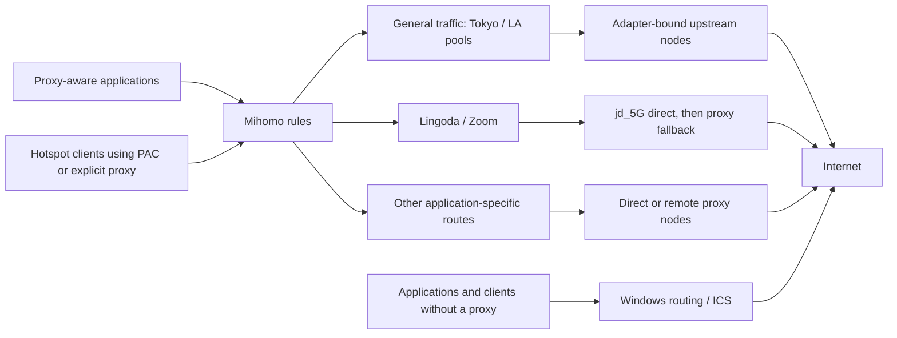

# Architecture

[Documentation index](../README.md) · [Operations](OPERATIONS.md)

The supported mode is `mihomo`: native Windows adapters, Mihomo proxy routing, adapter recovery, and Windows Mobile Hotspot. The general dispatch overlay was updated on 2026-10-26; see [dispatch and optimization logs](DISPATCH.md).

## Traffic paths

The main engine’s TUN is disabled. A separate Codex cloud-only engine installs backend IP host routes and relays through the main engine; see [its configuration and limits](CONFIGURATION.md#codex-cloud-tunnel). Setting the Windows user proxy does not intercept every application's traffic or all UDP/WebRTC media. Hotspot clients using only Internet Connection Sharing (ICS) follow Windows routing; they do not automatically use Mihomo's pools.

ICS shares one adapter, and sharing it disables Mihomo's interface-bound path on that same adapter (measured 2026-10-27: 0 bytes while shared, 509 KB/s once released). A hotspot client's non-proxied traffic therefore consumes the shared link both as its only Internet path and as a link the proxy can no longer bind; `config/network-architecture.json` -> `hotspotUplink` can pin that link, and the source policy now prefers `jd_5G`. The October 30 incident records show ICS instead sharing `pisen_2026_03`. Policy preference is not proof of effective ownership; see [the unresolved role mismatch](HANDOFF.md#known-gaps-and-next-work). Evidence in [the WeChat hotspot note](../tasks/WECHAT-HOTSPOT-SPEEDUP.md).

| Policy | Configured behavior |
|---|---|
| `AUTO`, `DATA` | Prefer Tokyo's bounded capacity-weighted connection rotation across healthy adapter paths, with the existing LA pool as fallback |
| `LINGODA`, `ZOOM` | Prefer `WAN-jd_5G` direct, then Tokyo, LA, and configured provider alternatives |
| `CHATGPT`, `ANTHROPIC`, `GOOGLE`, `IB`, `DEV` | Stable fallback beginning with Tokyo and LA; remaining choices depend on the group |
| `DISPATCH` | Prefer `WAN-ACTIVE`: bounded capacity-weighted destination hashing; retain direct adapter and Windows-selected `DIRECT` fallbacks |
| `LOCAL` | Selector between `DISPATCH` and `DIRECT` |

Ordered rules can choose more specific application groups before the general fallback. Check the [template](../../config/mihomo-config.template.yaml) for exceptions such as Gmail and download hosts. Saved controller selections can override a group's first configured member; inspect the effective selection when diagnosing routing.

`BALANCED-<adapter>` and `LA-<adapter>` nodes bind their remote proxy connections to that adapter. Unbound upstream nodes use `DISPATCH`. Connect911 subscriptions and their provider pools have been retired.

`standbyAdapters` in `network-architecture.json` is the legacy pool policy. The builder applies [dispatch-policy.json](../../config/dispatch-policy.json) afterward for managed regions. WAN and Tokyo now use independently measured capacity priors and shared health providers; the previous LA rotation is retained. Historical adapter speed measurements do not establish current capacity. Small HTTPS responses alone do not justify an equal share of downloads.

Pool HTTPS checks run every 30 seconds and `DISPATCH` checks every 15 seconds; application groups have their own URLs and intervals. A passing probe establishes reachability to that probe target, not sustained throughput or application authentication. Failover takes detection time and affects new connections. A TCP flow cannot combine adapter bandwidth or migrate between failed paths; shared carrier capacity can also limit aggregate speed.

## Configuration ownership

| Source | Owns |
|---|---|
| [network-architecture.json](../../config/network-architecture.json) | Supported architecture metadata, pool standby policy, and the opt-in hotspot uplink policy; `mode` must be `mihomo` |
| [mihomo-adapters.json](../../config/mihomo-adapters.json) | Device identities, managed names, optional static IPv4 settings, and declared Windows default-route preference |
| [mihomo-config.template.yaml](../../config/mihomo-config.template.yaml) | Sanitized routing policy, groups, DNS, and listener settings |
| [Build-MultiWanConfig.py](../../tools/Build-MultiWanConfig.py) | Generated adapter nodes, pools, provider replicas, and stable application groups |
| `runtime/config.yaml` and `runtime/providers/` | Private deployed configuration and provider caches |

The physical managed names are `iPhone 17 pro max`, `pisen_2026_10`, `jd_5G`, and `pisen_2026_03`. The iPhone retains the logical proxy slot `win_turbo_phone`, mapped by `interfaceBindings` and `proxySlot`. The phone and newer Pisen use device addressing; JD is configured as `192.168.0.250/24` via `192.168.0.1`, and older Pisen as `192.168.1.100/24` via `192.168.1.1`. Device identity is matched by recorded MAC, interface GUID, or PnP ID. Missing or ambiguous matches are left unchanged.

`routeMetric` and `interfaceMetric` in that map declare Windows route preference. The expected sums are JD 10, iPhone 25, older Pisen 40, and newer Pisen 70. Recovery reconciles interface metrics and existing IPv4/IPv6 default-route metrics behind the stable-idle guard; Pisen 10 also declares an IPv4 MTU of 1400. These are desired settings, not proof of current routes. See the [adapter reference](CONFIGURATION.md#adapter-identity-addressing-and-metrics). Bound Mihomo paths retain their own interface selection.

`fallbackOrder` in [dispatch-policy.json](../../config/dispatch-policy.json) sets the same ranking for the generated `DISPATCH` fallback group, after `WAN-ACTIVE`: `WAN-jd_5G`, `WAN-pisen_2026_03`, `WAN-win_turbo_phone`, `WAN-pisen_2026_10`, then `DIRECT`. It must list every managed adapter exactly once; the builder rejects anything else. `WAN-ACTIVE` itself stays a capacity-weighted load-balance group, so its share comes from `capacitiesMbps`, not from this order.

| Listener | Purpose |
|---|---|
| `0.0.0.0:7897` | Mixed HTTP/SOCKS proxy, including LAN clients |
| `127.0.0.1:9097` | Local controller; `/ui/` serves the optional installed dashboard |
| `127.0.0.1:19989` | Required private main-engine Codex egress, routed to `CHATGPT`; verify deployment |
| `127.0.0.1:19990` / `19997` | Auxiliary Codex tunnel mixed proxy / controller |
| `127.0.0.1:53` | Mihomo DNS listener |
| `0.0.0.0:8080` | Separate PAC server; generated PAC currently points clients to `192.168.137.1:7897` |

The DNS listener alone does not prove Windows uses it. `LOCAL`/`DIRECT` domain rules also feed the generated PAC. See [hotspot troubleshooting](OPERATIONS.md#troubleshooting) when LAN addressing changes.

## Startup and recovery

| Component | Owner and trigger |
|---|---|
| `MihomoAdapterRecovery` | SYSTEM task, Windows PowerShell 5.1, boot trigger delayed 15 seconds |
| `Mihomo-Startup.vbs` | User Startup folder; PowerShell 7 launches the proxy supervisor and bounded boot observer |
| `MihomoHotspot` | Interactive-user task, Windows PowerShell 5.1, logon trigger delayed 30 seconds |
| `Mihomo-PacServer.vbs` | User Startup folder; PowerShell 7 runs the PAC server |
| `MihomoCodexCloudTunnel` | Elevated interactive-user logon task, separate engine for backend host routes |
| Optional Codex launcher | User shortcut; Windows PowerShell 5.1 waits for proxy HTTPS before opening the app |

Adapter reconciliation repeats after a 10-second sleep. Stall checks run at least 30 seconds apart. Restart eligibility requires three failures spanning at least 90 seconds, another working adapter, and failed direct probes to both domestic targets. Established TCP sessions, adapter-bound UDP endpoints, or the hotspot's shared upstream prevent restart. Unknown protection state defers it. Attempts are recorded before restart, with a 15-minute cooldown and at most three attempts per hour.

The supervisor starts Mihomo when port 7897 is free and retries after exits. An occupied port prevents another launch; it does not prove the listener is this project's healthy proxy. Startup retains the deployed configuration rather than rebuilding it.

The supervisor launches the headless dispatch controller at startup. Its repeating helper checks cover PAC and diagnostics, so verify the dispatch status timestamp separately after a controller exit. It only changes managed bucket preferences through the local API and records bounded rotating logs; see [controller limits and rollback](DISPATCH.md#startup-changes-and-rollback).

Historical measurements and pending physical reboot/replug checks are recorded in [verification notes](../verification/2026-10-21.md).
