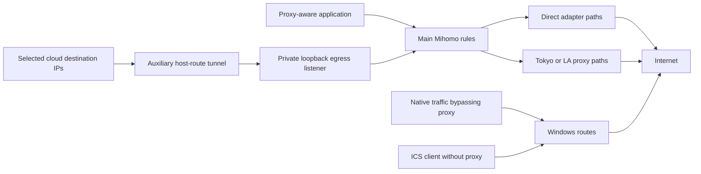

# Architecture

[Documentation index](../README.md) · [Configuration](CONFIGURATION.md) · [Operations](OPERATIONS.md)

## Traffic and trust boundaries

The main template has TUN disabled. User proxy settings affect applications that honor them; they do not capture arbitrary native sockets, all UDP, WebRTC or all hotspot traffic. Broker-native connections can therefore follow a different adapter from a similarly named Mihomo group. The auxiliary tunnel is destination-IP based, not process based; other traffic to a shared destination IP can also enter it.

The public mixed proxy binds loopback. Exposing it to a LAN requires a deliberate configuration and firewall review. ICS supplies sharing through one Windows uplink; it does not automatically route every client into the proxy. The PAC helper advertises a fixed private-network proxy address with `DIRECT` fallback, so a client can bypass the proxy when it is unreachable. See [listener defaults](CONFIGURATION.md#listeners-and-exposure).

## Design rationale and ownership

| Component | Owns | Does not establish |
|---|---|---|
| Main Mihomo | Ordered rules, proxy groups and individual flow paths | Authenticated app success or continuity through path loss |
| Windows routing/ICS | Native routes and shared uplink | Proxy pool participation by every application |
| Adapter recovery | Recorded identity/address reconciliation and guarded route/MTU work | Safe mutation when inspection is uncertain |
| Adaptive dispatcher | Bounded selection changes in its generated groups | Automatic learning of physical capacity |
| Proxy supervisor | Core process startup/retry and selected sidecars | That any occupied listener is this project's healthy core |
| Dashboard collector/server | Snapshot production and local read-only serving | A fresh live inspection on each HTTP request |
| Provider applications | Requests, concurrency, exact-key protection, data quality and publication | Network readiness from idle counters alone |

The native design keeps independent application policy and adapter choices in Mihomo and Windows rather than requiring a VM or external NIC dispatcher. Stable logical slots preserve group names when the physical tether changes. Existing connections keep the path chosen when created; a selector change governs subsequent choices, not a guaranteed migration of established flows.

## Generation versus deployment

The sanitized template is a native baseline produced by the legacy builder transform. Base nodes in that template use `DISPATCH`. The full builder CLI applies `AdaptiveDispatch.apply_policy` afterward when the dispatch policy file exists; that overlay creates `PROXY-UPLINK` and rewrites matching base dialers to it. These are different stages, not contradictory runtime observations.

The full builder regenerates nodes and groups. The overlay only replaces managed dispatch groups/providers and preserves application rules. Neither activates its output. Configuration JSON edits also do not necessarily alter a running core. Guarded activation validates a private candidate, saves backup/config identity and selectors, reloads, probes, and commits or attempts rollback. See [operations](OPERATIONS.md#routing-changes).

## Startup and recovery

Registered adapter recovery runs as SYSTEM at boot; proxy/PAC and hotspot launches depend on the intended user's logon. The proxy startup launcher uses PowerShell 7; WinRT hotspot operations use Windows PowerShell 5.1. The cloud tunnel is a separate elevated interactive-user task. Optional app launchers are not prerequisites for routing.

The supervisor retries the main core after exit and avoids a second launch when port 7897 is occupied. Repeated helper maintenance covers PAC and network diagnostics, not a complete watchdog for every controller. Adaptive dispatch is started at startup; check its own status timestamp after a crash. Optional WSL telemetry has its own lock and lifecycle.

Route changes require a continuously observed stable idle inventory for 120 seconds; observation gaps above 45 seconds, clock reversal, active TCP/UDP, shared hotspot ownership or inspection errors defer them. This may defer changes indefinitely. Stall recovery separately requires repeated failures, a working alternative, direct reachability checks, protected-session inspection and restart budget/cooldown limits. Guards do not prevent hardware disappearance, DHCP changes or externally recreated routes.

## Known limitations and proposals

ICS sharing has historically conflicted with interface-bound traffic on the shared adapter. Actual ownership must be inspected; the configured hotspot preference is not proof of Windows state. The generator still includes every managed adapter in relevant providers. `initialEligible` and putting an adapter last do not implement a hard shared-adapter exclusion.

Explicit ownership-aware exclusion during rebuild remains a proposal, not an implemented guarantee. No bandwidth, client Wi-Fi speed, broker login, terminal data freshness, physical replug or reboot acceptance is inferred from source tests. Historical calibration values are scheduling inputs, not current capacity certificates.
